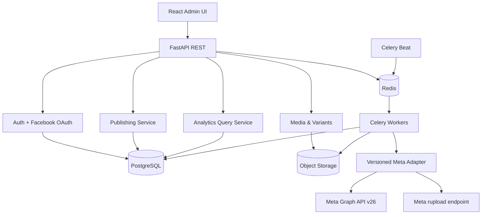
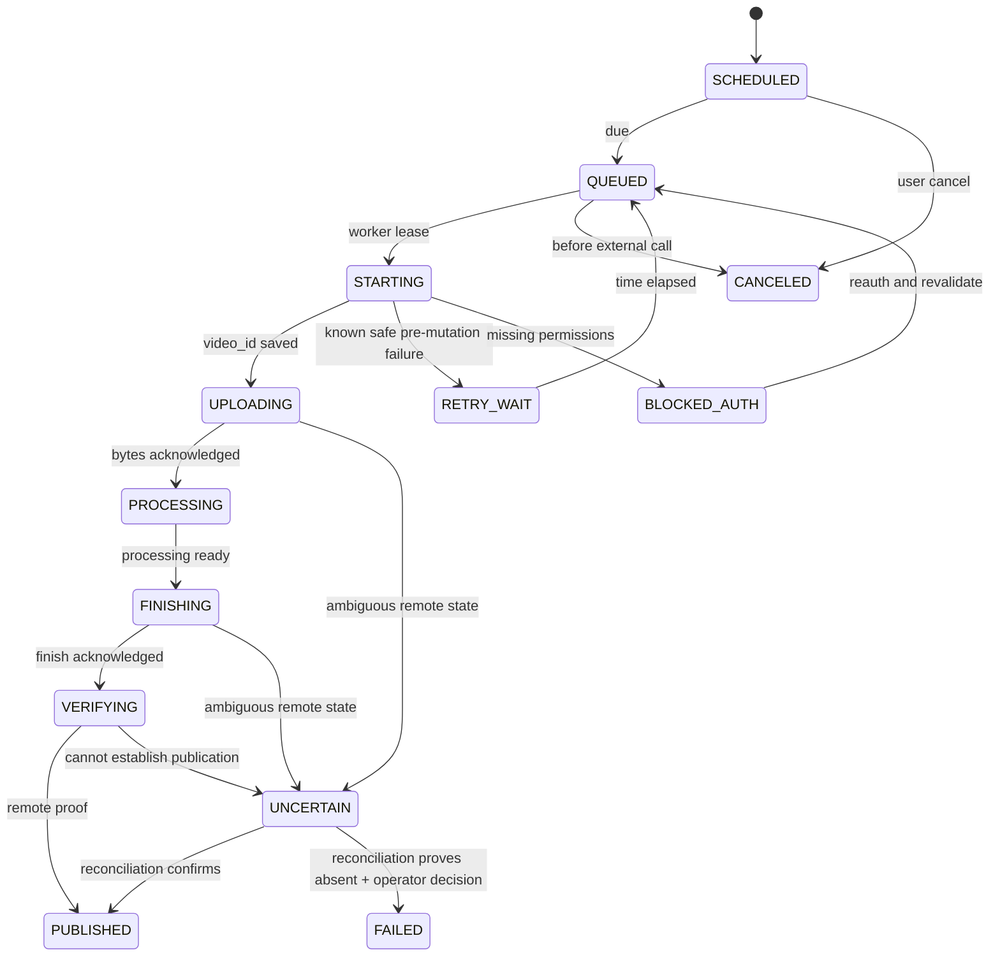

# FACEBOOK REELS STUDIO — TECHNICAL SPECIFICATION & IMPLEMENTATION PLAN

**Version:** 1.0  
**Ngày chốt thiết kế:** 2026-10-15  
**Đối tượng:** Tool web nội bộ phục vụ 10–50 Facebook Fanpages do người vận hành có quyền quản lý.  
**Mục tiêu delivery:** P0 kiểm chứng Meta API **trên tài khoản/Page thật**, sau đó P1 Core Management, P2 Analytics, P3 Bulk Publishing.  
**Trạng thái:** **Specification / chưa implement / chưa có bằng chứng chạy trên Meta App của chủ sở hữu.**

> **Nguyên tắc không thương lượng:** Một tài liệu kỹ thuật có nguồn dẫn không đồng nghĩa API được Meta phê duyệt hoặc hoạt động với Page của bạn. Các mục ghi **LIVE-GATE** phải chạy qua Graph API với quyền hợp lệ rồi lưu bằng chứng đã loại bỏ token trước khi xác nhận.

---

## 0. Executive decisions và definition of success

### 0.1 Quyết định cố định

| Chủ đề | Quyết định |
|---|---|
| Sản phẩm | Một web app quản lý Facebook Page Reels, không làm social platform đa kênh |
| Người dùng | Chủ sở hữu/nhân sự vận hành nội bộ; không có public multi-tenant SaaS |
| Quy mô | Tối đa 50 Pages theo cấu hình mặc định; mở rộng theo capacity test |
| Kiến trúc | Modular monolith; REST API + worker bất đồng bộ |
| UI | React + TypeScript + Tailwind CSS; responsive desktop-first |
| API | Python FastAPI + Pydantic v2 + SQLAlchemy 2 + Alembic |
| Data | PostgreSQL; UTC trong DB, hiển thị theo Asia/Ho_Chi_Minh |
| Jobs | Redis + Celery worker + Celery Beat; PostgreSQL là source of truth |
| Storage | Local/MinIO dev; S3-compatible production; signed URL, encryption |
| Media | ffprobe; FFmpeg normalize chỉ khi người dùng chọn và quy tắc đã kiểm thử |
| Meta | Graph API v26.0 (đóng gói qua adapter versioned, nâng cấp cấu hình) |
| Lịch Reels | Internal scheduler; không giả định native Meta Reel scheduling hoạt động |
| Analytics | Metrics catalog + raw provenance + snapshots; missing khác zero |
| Bảo mật | Facebook Login OAuth, server-side credentials, mã hóa token, audit |

**Out of scope P0–P3:** TikTok/Instagram, marketplace quản lý khách hàng, Ads Manager, kiếm tiền Facebook/earnings, auto-reply inbox, scraping đối thủ, đăng bằng cookie/browser automation, AI sinh video/caption, hệ thống approvals nhiều tổ chức, native mobile app.

### 0.2 Definition of Done toàn dự án P0–P3

1. Kết nối quyền hợp lệ tới tối thiểu 2 Page thuộc quyền quản lý thực tế; liệt kê và nhận biết Page không có quyền.
2. Từ UI upload asset, tạo variant caption, chọn tối đa 50 Page, xem bản preview, lên lịch độc lập.
3. Mỗi target Page được quản lý bằng job riêng, duy trì trạng thái chính xác qua restart, outage, timeout và token lỗi.
4. Có xác nhận bài Reel thực sự được xuất bản, kèm `fb_video_id` và permalink nếu API hỗ trợ.
5. Đồng bộ ít nhất một metric view **ở cấp Reel riêng biệt** sau khi kiểm chứng được Graph object và metric tương ứng; gắn nguồn, tuổi dữ liệu và khoảng thời gian.
6. Dashboard thống kê Reels xuất bản bằng tool và Reels có sẵn trên Page nếu endpoint listing cho phép; mọi hạn chế phải được thể hiện trong sản phẩm.
7. Không tự động đăng trùng khi Meta trả trạng thái không xác định; không lưu token plaintext/log.
8. Các automated gate và live gate đạt; evidence, migration, docs vận hành đầy đủ.

### 0.3 Rủi ro cần chốt ở P0, không được giấu trong P2

| Mã | Rủi ro / câu hỏi | Xử lý |
|---|---|---|
| META-01 | Scope và Page tasks thực tế có đủ đăng/đọc? | GET `/me/accounts`, kiểm thử Page token trên từng Page |
| META-02 | `POST /{page-id}/video_reels` hoạt động trong v26 với app hiện tại? | Live upload → finish → verify |
| META-03 | `video_id` từ upload map ra `post_id` nào? | List Page VideoReels và đối chiếu permalink/object IDs |
| META-04 | `post_media_view` áp dụng đúng Reel object nào? | Thử post insights trên ID đã xác minh; lưu raw response đã khử bí mật |
| META-05 | Page Insights có dữ liệu không? | Page Insights probe; lưu lý do unavailable, không thay 0 |
| META-06 | Reels cũ đăng trực tiếp từ Facebook đọc được không? | List/lookup và đối soát 1–3 Reels có sẵn |
| META-07 | Format, kích thước, duration được chấp nhận? | 3 video fixtures ngắn / giới hạn trên kiểm tra trên phiên bản API hiện tại |
| META-08 | App Standard Access đủ cho các account/Page nội bộ? | Test account app role và Page tasks; không giả định mọi Page hoạt động |

---

## 1. Product requirements / user journeys

### 1.1 Roles (internal only)

- **OWNER**: quản lý OAuth connections, quyền, cấu hình, lịch đăng, hủy job, xem log và analytics.
- **EDITOR** (P3 optional): upload, tạo variant, lên lịch trên Page được cấp; không xem token hoặc thay quyền.
- P0/P1 có thể chỉ có OWNER; thiết kế `app_users.role` để tránh phải phá schema sau này.

### 1.2 Core journeys

**J1 – Connect and onboard Pages**  
Owner đăng nhập nội bộ → Connect Facebook → grant scope → OAuth callback → backend truy vấn `/me/accounts` → hiển thị Page và tasks/capability → owner chọn Page cần kích hoạt → ghi nhận token mã hóa và health check.

**J2 – Publish single Reel**  
Upload MP4 → probe metadata → tạo caption/variant → chọn một Page → confirm → job `queued` → Meta start → upload → status → finish → verify → `published`; có audit/permalink. Không coi finish HTTP 200 là published nếu chưa xác minh.

**J3 – Schedule multi-page**  
Chọn asset/variant → tick 10–50 Page → thiết lập caption/time theo Page → preview matrix → confirm batch → create one job per Page → scheduler dispatch job đúng thời điểm; từng Page lỗi không làm các Page khác rollback.

**J4 – Analytics**  
Dashboard lọc theo Page, khoảng ngày đăng, chủ đề, trạng thái → sync data → hiển thị per-Reel views, totals, freshness, metadata provenance → export CSV. **Không cộng các snapshot lifetime theo ngày.**

**J5 – Recovery**  
Mạng lỗi khi upload/finish → job `uncertain` hoặc retry an toàn tùy phase → reconciliation bằng ID đã lưu → người dùng được xem trạng thái/diễn giải → chỉ cho manual retry khi nguy cơ double-publish đã loại trừ.

### 1.3 Functional priorities

| ID | Requirement | Phase | Acceptance |
|---|---|---|---|
| FR-001 | Facebook Login và Page discovery | P0→P1 | Page IDs đúng, scope/tasks rõ ràng, không mất token |
| FR-002 | API live publish proof | P0 | Reel thực xuất hiện, truy vấn status/permalink |
| FR-003 | Reel views live proof | P0 | 1+ per-Reel view metric được chứng minh hoặc formal no-go |
| FR-004 | Multiple connections | P1 | Nhiều người quản trị liên kết, không xung đột Page IDs |
| FR-005 | Media upload and validation | P1 | MP4 upload, metadata/hash, thông báo lỗi rõ |
| FR-006 | Publish 1 Page từ UI | P1 | State machine bền qua restart |
| FR-007 | Reels discovery/backfill | P2 | Đồng bộ Reels có sẵn trong API coverage |
| FR-008 | Metric snapshots + dashboard | P2 | Metrics định nghĩa rõ, null vs 0, provenance |
| FR-009 | Multi-page batch scheduling | P3 | Tạo 1 job/Page và 1 kết quả/Page |
| FR-010 | Retry, cancel, reconcile | P1/P3 | Không double-publish trong các tình huống đã mô phỏng |
| FR-011 | Filters/rankings/export | P2/P3 | Timezone, pagination, CSV bảo toàn số liệu |
| FR-012 | Health and audit | P1→P3 | Trace lỗi mà không tiết lộ credential |

---

## 2. Meta integration — external contract / probes

**Authoritative references:**

- Graph changelog: https://developers.facebook.com/docs/graph-api/changelog/
- Reels guide: https://developers.facebook.com/documentation/video-api/guides/reels-publishing
- VideoReels reference: https://developers.facebook.com/docs/graph-api/reference/page/video_reels/
- Page insights: https://developers.facebook.com/docs/graph-api/reference/insights/
- Post insights: https://developers.facebook.com/docs/graph-api/reference/post/insights/
- Meta permission reference: https://developers.facebook.com/documentation/development/permissions
- Meta Postman examples: https://www.postman.com/meta/facebook/documentation/r56bjfd/facebook-api

Meta references là authority; Postman collection là request example, có thể cũ. Với v26, luôn kiểm tra parameter casing (`start` so với enum `START`), supported fields và video requirements bằng live probe. **Không copy giới hạn video từ Instagram Reels sang Facebook Reels.**

### 2.1 Proposed scopes and authorization

| Capability | Initial scope(s) | Gate |
|---|---|---|
| List Pages | `pages_show_list` | Test `/me/accounts` có đủ Page được quản lý |
| Read Page information | `pages_read_engagement` | Test query Page/profile fields |
| Publish | `pages_manage_posts` + dependencies | Test start/upload/finish bằng Page token |
| Insights | `read_insights`, `pages_read_engagement`, `pages_show_list` | Test Page và Post metrics |
| Read Page-owned content | Xác minh có cần `pages_read_user_content` đối với dữ liệu cụ thể | Chỉ yêu cầu bổ sung nếu probe có bằng chứng |
| Additional Business permissions | Không mặc định `business_management` | Chỉ thêm nếu cần và quyền được duyệt |

**OAuth:** Backend bắt đầu Facebook Login với `state` CSRF, nhận code vào callback HTTPS, trao đổi code server-side, lấy token người dùng phù hợp, rồi lấy Page tokens được Meta trả về. Ghi thời điểm kiểm tra, quyền được cấp và Page tasks. Nếu app chỉ dùng cho người có app role/asset access phù hợp thì thử Standard Access trước; không giả định mọi người quản lý Page đều được miễn App Review. Live mode/Advanced Access phụ thuộc ai sử dụng app, vai trò và chính sách Meta hiện hành.

**P0 checkpoint:** Không bao giờ yêu cầu paste token vào frontend trong production. P0 CLI trên máy riêng có thể dùng secret từ environment, không commit evidence nguyên token.

### 2.2 Request inventory (Meta external)

| Operation | Request pattern | Success evidence |
|---|---|---|
| List Page access | `GET /v26.0/me/accounts?fields=id,name,access_token,tasks` với user token | Actual managed Page ID/task list |
| Page info | `GET /v26.0/{page-id}?fields=id,name` với Page token | Correct Page identity |
| Create upload session | `POST /v26.0/{page-id}/video_reels` `upload_phase=start` | `video_id`, `upload_url` |
| Upload local file | `POST {upload_url_returned_by_Meta}` với binary + headers theo spec | Complete upload acknowledgement |
| Processing status | `GET /v26.0/{video-id}?fields=status` | Status response correlated with `video_id` |
| Publish Reel | `POST /v26.0/{page-id}/video_reels` `upload_phase=finish`, `video_id`, `video_state=PUBLISHED`, optional `description`,`title` | `success:true` + subsequent verify |
| List existing Reels | `GET /v26.0/{page-id}/video_reels` | Items, Page ownership, available identifiers |
| Page Insights | `GET /v26.0/{page-id}/insights?metric=page_media_view&period=day` | Metric response or documented unavailable |
| Reel/Post Insights | `GET /v26.0/{verified-post-id}/insights?metric=post_media_view` | **Proved** Reel-level metric from correct object |
| Access diagnostic | Debug token API / permission inspection as authorized | Credential metadata, no log token |

**Important nuances:**

- Some official examples use `/me/video_reels` with Page token; reference documents `/{page-id}/video_reels`. P0 tests the canonical Page route and records fallbacks, never builds different routes on assumptions.
- The API may expose a video object ID, post ID, and permalink separately. The tool stores them **separately**, never guesses one from another.
- A success response from upload or finish is **not** final proof of the Reel becoming visible.
- Although Postman examples list `video_state=SCHEDULED`, **do not** use it for internal calendar until the exact scheduling semantics and parameters are demonstrated on v26. Default = publish `PUBLISHED` at the actual scheduled timestamp via our worker.
- `post_media_view` is lifetime at post level where supported; `page_media_view` is Page-level periodic data and **cannot** be divided into individual Reels.
- Page Insights limitations may include a threshold of at least 100 Page likes and delayed refresh (~24h). A 0, a missing metric, and a permission failure are three different states.
- All fields/permissions/API error codes can change; `MetaAdapter` maps them into stable internal contracts.

### 2.3 P0 live experimental protocol (no mock substitute)

**Preparation:** Meta developer app controlled by owner; HTTPS callback; 2+ test Pages with explicit management permission; test MP4 self-owned content; Page token; environment file ignored by Git. Never upload production-sensitive video during exploratory tests without owner approval.

**Live probes:**

1. `P0-M01`: Inspect app role and requested/granted permissions; save masked evidence.
2. `P0-M02`: Complete OAuth end-to-end; verify signed `state` and error callback.
3. `P0-M03`: `GET /me/accounts` for 2 Page IDs and task list; test unauthorized Page path.
4. `P0-M04`: Access Page metadata and Page token health.
5. `P0-M05`: Start Reel upload and persist `video_id`/`upload_url` (do not log URL if sensitive).
6. `P0-M06`: Upload local test MP4 with headers matching active spec; capture `fbtrace_id`, response code, sanitized body.
7. `P0-M07`: Poll status with bounded retries; inspect exact state shape.
8. `P0-M08`: FINISH with caption/title unique test marker. Verify Page feed/Reels view and permalink when supported.
9. `P0-M09`: Enumerate Reel through Page VideoReels edge; map video/post IDs, metadata and links.
10. `P0-M10`: Fetch `post_media_view` using observed/verified post ID(s), not guessed ID; also page-level `page_media_view`.
11. `P0-M11`: Import a pre-existing Reel and check its view metric path.
12. `P0-M12`: Repeat on second Page; test permission denied and safe handling of expired/revoked token without publishing.
13. `P0-M13`: Evaluate failures: unsupported media, malformed param, canceled test, Meta processing delay.
14. `P0-M14`: Compare sample views to Meta UI, record timestamp, metric definitions and expected lag; do not demand exact real-time equality.

**Evidence artifact:** `evidence/p0/meta_feasibility_matrix.md`, `evidence/p0/sanitized_responses/*.json`, `evidence/p0/page_video_object_mapping.csv`, `evidence/p0/decision.json`. Evidence must redact tokens, names/IDs as needed for sharing, signed URLs, emails and app secrets. Store sensitive raw records only in access-controlled local storage; exclude from Git.

**Gate result values:** `PASS`, `PASS_WITH_RESTRICTIONS`, `BLOCKED`, `FAIL`. `P0-GO` requires minimum successful Page auth + publish + final verification + Reel-level view retrieval on ≥1 real Reel and repeatable Page access for ≥2 Pages. `PASS_WITH_RESTRICTIONS` only if named noncritical metrics/fields fail; analytics will show `N/A`. If publishing is impossible => **NO-GO publishing**, if individual view metric inaccessible => **NO-GO for promised Reels Analytics**. Do not quietly replace individual views with Page total views.

---

## 3. Architecture / module boundaries



**Services within one repo:**
- `auth`: internal sessions, OAuth callback, credentials encryption, page connection health.
- `pages`: discovery, activation, filtering, capability flags.
- `media`: upload, dedupe via SHA-256, probe, variants.
- `publishing`: batch, job state, transaction, scheduling, attempts, safe retry.
- `meta_adapter`: HTTP, Graph version, backoff, response/error normalization, published-object reconciliation.
- `analytics`: reel ingestion, metrics registry, polling, snapshots, query aggregation.
- `observability`: audit, health, structured logs, metrics, alerts.

### 3.1 Suggested repo layout

```text
facebook-reels-studio/
  apps/web/src/{app,pages,features,components,lib,api}/
  services/api/app/
    main.py
    api/v1/{auth,pages,media,variants,batches,jobs,reels,analytics,health}.py
    core/{config,security,db,errors,logging}.py
    modules/{auth,pages,media,publishing,analytics}/
    integrations/meta/{client,oauth,reels,insights,schemas,errors}.py
    workers/{celery_app,publish_tasks,sync_tasks,beat_schedule}.py
    models/
    schemas/
  migrations/versions/
  tests/{unit,contract,integration,e2e,live_meta}/
  infra/{docker,nginx,minio}/
  docs/{architecture,api,operations,adr}/
  evidence/p0/            # sanitized-only evidence
  .env.example
  docker-compose.yml
```

### 3.2 Reliability design

PostgreSQL is authoritative; Redis/Celery is delivery mechanism, not a durable record of intent. Use DB transactional outbox or a dispatch sweep (`SELECT ... FOR UPDATE SKIP LOCKED`) to enqueue due jobs. A Redis outage must not erase scheduled jobs. Worker leases and recovery sweep must identify stale `running` jobs; a stale job in any external mutation phase becomes `uncertain` pending reconciliation, not blind repost.

**Initial worker limits are conservative configuration, not claims about Meta quotas:** global publish concurrency 2, max 1 active publish per Page; Meta Insights worker separately with bounded concurrency 2; jittered exponential backoff on explicit retryable errors; service monitors `x-app-usage`, `x-page-usage`, `Retry-After` if returned. Real limits come from measured API responses and app context, not hardcoded folklore.

---

## 4. Data model and SQL schema (PostgreSQL)

### 4.1 Modeling rules

- IDs internal = UUID; Meta IDs = **TEXT**, not INTEGER/float.
- `created_at`,`updated_at`,`scheduled_at`,`published_at`,`collected_at` = `timestamptz` UTC.
- `media_assets` are immutable bytes (hash); `content_variants` carry caption/title and semantic metadata; a batch contains immutable per-Page targets.
- `publish_jobs` represent one variant × one target Page × one scheduled occurrence, with idempotency.
- `publish_attempts` record attempts and Meta phases; `published_reels` represent actual on-Facebook objects and can also include `IMPORTED` content.
- Metric name/version, unit, level, window, capture time, response provenance are first-class; `UNAVAILABLE` ≠ zero.
- Credentials encrypted at application layer; only key identifier and ciphertext in DB.

### 4.2 Initial migration DDL (illustrative, implement via Alembic)

```sql
CREATE EXTENSION IF NOT EXISTS pgcrypto;

CREATE TABLE app_users (
  id uuid PRIMARY KEY DEFAULT gen_random_uuid(),
  email text NOT NULL UNIQUE,
  password_hash text,
  role text NOT NULL DEFAULT 'OWNER' CHECK (role IN ('OWNER','EDITOR')),
  created_at timestamptz NOT NULL DEFAULT now()
);

CREATE TABLE fb_connections (
  id uuid PRIMARY KEY DEFAULT gen_random_uuid(),
  owner_user_id uuid NOT NULL REFERENCES app_users(id),
  fb_user_id text NOT NULL,
  display_name text,
  user_token_ciphertext bytea NOT NULL,
  key_version integer NOT NULL DEFAULT 1,
  token_expires_at timestamptz,
  granted_scopes jsonb NOT NULL DEFAULT '[]',
  connection_status text NOT NULL DEFAULT 'ACTIVE'
    CHECK (connection_status IN ('ACTIVE','NEEDS_REAUTH','REVOKED','ERROR')),
  last_verified_at timestamptz,
  created_at timestamptz NOT NULL DEFAULT now(),
  updated_at timestamptz NOT NULL DEFAULT now(),
  UNIQUE (owner_user_id, fb_user_id)
);

CREATE TABLE fb_pages (
  id uuid PRIMARY KEY DEFAULT gen_random_uuid(),
  connection_id uuid NOT NULL REFERENCES fb_connections(id),
  fb_page_id text NOT NULL UNIQUE,
  name text NOT NULL,
  page_token_ciphertext bytea NOT NULL,
  token_key_version integer NOT NULL DEFAULT 1,
  tasks jsonb NOT NULL DEFAULT '[]',
  capabilities jsonb NOT NULL DEFAULT '{}',
  enabled boolean NOT NULL DEFAULT false,
  health_status text NOT NULL DEFAULT 'UNKNOWN',
  last_verified_at timestamptz,
  created_at timestamptz NOT NULL DEFAULT now(),
  updated_at timestamptz NOT NULL DEFAULT now()
);

CREATE TABLE media_assets (
  id uuid PRIMARY KEY DEFAULT gen_random_uuid(),
  owner_user_id uuid NOT NULL REFERENCES app_users(id),
  sha256 text NOT NULL UNIQUE CHECK (length(sha256)=64),
  storage_key text NOT NULL UNIQUE,
  filename text NOT NULL,
  content_type text NOT NULL,
  size_bytes bigint NOT NULL CHECK (size_bytes>0),
  duration_ms integer,
  width integer,
  height integer,
  video_codec text,
  audio_codec text,
  validation_status text NOT NULL DEFAULT 'PENDING'
    CHECK (validation_status IN ('PENDING','VALID','INVALID','ERROR')),
  validation_report jsonb NOT NULL DEFAULT '{}',
  created_at timestamptz NOT NULL DEFAULT now()
);

CREATE TABLE content_variants (
  id uuid PRIMARY KEY DEFAULT gen_random_uuid(),
  asset_id uuid NOT NULL REFERENCES media_assets(id),
  title text NOT NULL DEFAULT '',
  caption text NOT NULL DEFAULT '',
  tags jsonb NOT NULL DEFAULT '[]',
  created_by uuid NOT NULL REFERENCES app_users(id),
  created_at timestamptz NOT NULL DEFAULT now()
);

CREATE TABLE publish_batches (
  id uuid PRIMARY KEY DEFAULT gen_random_uuid(),
  created_by uuid NOT NULL REFERENCES app_users(id),
  name text NOT NULL,
  client_idempotency_key text NOT NULL UNIQUE,
  submitted_at timestamptz NOT NULL DEFAULT now(),
  request_fingerprint text NOT NULL,
  target_count integer NOT NULL DEFAULT 0
);

CREATE TABLE publish_jobs (
  id uuid PRIMARY KEY DEFAULT gen_random_uuid(),
  batch_id uuid NOT NULL REFERENCES publish_batches(id),
  page_id uuid NOT NULL REFERENCES fb_pages(id),
  variant_id uuid NOT NULL REFERENCES content_variants(id),
  caption_override text,
  title_override text,
  scheduled_at timestamptz NOT NULL,
  status text NOT NULL DEFAULT 'SCHEDULED'
    CHECK (status IN ('SCHEDULED','QUEUED','STARTING','UPLOADING',
      'PROCESSING','FINISHING','VERIFYING','PUBLISHED','RETRY_WAIT',
      'BLOCKED_AUTH','UNCERTAIN','FAILED','CANCELED')),
  attempt_count integer NOT NULL DEFAULT 0,
  next_retry_at timestamptz,
  lease_owner text,
  lease_until timestamptz,
  meta_video_id text,
  last_error_code text,
  last_error_safe_message text,
  row_version integer NOT NULL DEFAULT 0,
  published_at timestamptz,
  created_at timestamptz NOT NULL DEFAULT now(),
  updated_at timestamptz NOT NULL DEFAULT now(),
  UNIQUE(batch_id, page_id),
  UNIQUE(meta_video_id)
);
CREATE INDEX idx_publish_jobs_due ON publish_jobs (scheduled_at, id)
  WHERE status IN ('SCHEDULED','RETRY_WAIT','QUEUED');
CREATE INDEX idx_publish_jobs_page_status ON publish_jobs (page_id, status, scheduled_at);

CREATE TABLE publish_attempts (
  id uuid PRIMARY KEY DEFAULT gen_random_uuid(),
  job_id uuid NOT NULL REFERENCES publish_jobs(id),
  attempt_number integer NOT NULL,
  meta_video_id text,
  phase text NOT NULL,
  outcome text NOT NULL DEFAULT 'STARTED',
  meta_trace_id text,
  http_status integer,
  graph_error_code text,
  graph_error_subcode text,
  sanitized_details jsonb NOT NULL DEFAULT '{}',
  started_at timestamptz NOT NULL DEFAULT now(),
  ended_at timestamptz,
  UNIQUE(job_id, attempt_number)
);

CREATE TABLE published_reels (
  id uuid PRIMARY KEY DEFAULT gen_random_uuid(),
  page_id uuid NOT NULL REFERENCES fb_pages(id),
  publish_job_id uuid UNIQUE REFERENCES publish_jobs(id),
  origin text NOT NULL CHECK (origin IN ('STUDIO','IMPORTED')),
  fb_video_id text NOT NULL,
  fb_post_id text,
  permalink_url text,
  caption text,
  posted_at timestamptz,
  last_seen_at timestamptz,
  remote_status text,
  created_at timestamptz NOT NULL DEFAULT now(),
  UNIQUE(page_id, fb_video_id)
);
CREATE INDEX idx_published_reels_page_date ON published_reels(page_id,posted_at DESC);
CREATE INDEX idx_published_reels_post_id ON published_reels(fb_post_id) WHERE fb_post_id IS NOT NULL;

CREATE TABLE metric_definitions (
  metric_key text PRIMARY KEY,
  graph_metric text NOT NULL,
  object_level text NOT NULL CHECK (object_level IN ('PAGE','POST','VIDEO')),
  value_kind text NOT NULL CHECK (value_kind IN ('COUNT','DURATION_MS','RATIO')),
  period text NOT NULL,
  api_version text NOT NULL,
  enabled boolean NOT NULL DEFAULT false,
  proven_at timestamptz,
  proof_notes text
);

CREATE TABLE analytics_sync_runs (
  id uuid PRIMARY KEY DEFAULT gen_random_uuid(),
  scope text NOT NULL,
  page_id uuid REFERENCES fb_pages(id),
  status text NOT NULL CHECK (status IN ('RUNNING','SUCCEEDED','PARTIAL','FAILED')),
  records_seen integer NOT NULL DEFAULT 0,
  error_summary text,
  started_at timestamptz NOT NULL DEFAULT now(),
  finished_at timestamptz
);

CREATE TABLE reel_metric_snapshots (
  id uuid PRIMARY KEY DEFAULT gen_random_uuid(),
  reel_id uuid NOT NULL REFERENCES published_reels(id),
  sync_run_id uuid NOT NULL REFERENCES analytics_sync_runs(id),
  metric_key text NOT NULL REFERENCES metric_definitions(metric_key),
  value numeric(24,6),
  availability text NOT NULL CHECK (availability IN ('AVAILABLE','UNAVAILABLE','ERROR')),
  unavailable_reason text,
  collected_at timestamptz NOT NULL DEFAULT now(),
  source_object_id text,
  graph_api_version text NOT NULL,
  CHECK ((availability='AVAILABLE' AND value IS NOT NULL) OR
         (availability<>'AVAILABLE' AND value IS NULL)),
  UNIQUE (sync_run_id,reel_id,metric_key)
);
CREATE INDEX idx_reel_metrics_latest ON reel_metric_snapshots(reel_id,metric_key,collected_at DESC);

CREATE TABLE page_metric_snapshots (
  id uuid PRIMARY KEY DEFAULT gen_random_uuid(),
  page_id uuid NOT NULL REFERENCES fb_pages(id),
  sync_run_id uuid NOT NULL REFERENCES analytics_sync_runs(id),
  metric_key text NOT NULL REFERENCES metric_definitions(metric_key),
  bucket_start timestamptz,
  bucket_end timestamptz,
  value numeric(24,6),
  availability text NOT NULL CHECK (availability IN ('AVAILABLE','UNAVAILABLE','ERROR')),
  unavailable_reason text,
  collected_at timestamptz NOT NULL DEFAULT now(),
  graph_api_version text NOT NULL,
  CHECK ((availability='AVAILABLE' AND value IS NOT NULL) OR
         (availability<>'AVAILABLE' AND value IS NULL))
);
CREATE INDEX idx_page_metrics_page_bucket ON page_metric_snapshots(page_id,metric_key,bucket_start DESC);

CREATE TABLE audit_logs (
  id bigint GENERATED ALWAYS AS IDENTITY PRIMARY KEY,
  actor_user_id uuid REFERENCES app_users(id),
  action text NOT NULL,
  subject_type text NOT NULL,
  subject_id text,
  safe_payload jsonb NOT NULL DEFAULT '{}',
  request_id text,
  created_at timestamptz NOT NULL DEFAULT now()
);
```

**Production schema refinements required P1:** add `updated_at` triggers or SQLAlchemy timestamps, optimistic concurrency protection, immutable publish batch snapshot/hash, outbox events, worker lease index, controlled deletion of media, token rotation history, connection/page relationships for duplicate owner transfer. DB schema above is baseline, not final migration without review.

### 4.3 Invariants

1. `(batch_id,page_id)` unique: batch không có hai job tới cùng một Page.
2. `client_idempotency_key` unique, kiểm tra cả `request_fingerprint`: cùng key + cùng payload trả batch cũ; cùng key + khác payload => 409.
3. One `meta_video_id` maps to one publish job; một published Reel duy nhất theo `(page_id, fb_video_id)`.
4. `publish_jobs.status=PUBLISHED` chỉ khi confirmed actual Facebook Reel; mỗi job có `published_at` và row `published_reels`.
5. `IMPORTED` Reel có `publish_job_id=NULL` và không được sửa trạng thái publishing.
6. Latest views = snapshot hợp lệ có `collected_at` gần nhất; view growth = **delta** snapshots đã tương thích metric definition và không vượt khác kỳ baseline.
7. Không SUM snapshot lifetime; Page bucket daily có thể SUM khi `bucket` không trùng nhau và cùng semantic/breakdown.
8. `availability=UNAVAILABLE` và `ERROR` có `value=NULL`; chỉ `AVAILABLE` mới có 0 thật.

---

## 5. Internal REST API contracts (not Meta API)

**Base URL:** `/api/v1`. **Auth:** secured HttpOnly SameSite session cookie, CSRF protection for mutations. **Content-Type:** `application/json` except upload. **Time:** UTC ISO-8601. **IDs:** UUID strings; Meta IDs = strings. **Pagination:** cursor (`items`, `next_cursor`) with stable `(created_at,id)` or `(posted_at,id)` ordering. **Mutations:** `Idempotency-Key` for batch creation and costly actions.

**Error envelope:**

```json
{
  "error": {
    "code": "PUBLISH_STATE_UNCERTAIN",
    "message": "Unable to confirm Facebook publish status; automatic replay blocked.",
    "retryable": false,
    "details": { "job_id": "uuid", "phase": "FINISH" }
  },
  "request_id": "req_..."
}
```

**Status mapping:** `400` schema/precondition invalid; `401` unauthenticated; `403` unauthorized Page/action; `404` not found; `409` conflict/idempotency mismatch/immutable state; `422` validation rejected; `429` internal throttle; `502` upstream protocol error; `503` upstream unavailability. Graph HTTP errors are normalized; never return raw tokens, vendor stack trace or upload URLs.

### 5.1 Auth & Pages API

| Verb/path | Input | Response / behavior |
|---|---|---|
| `GET /auth/facebook/start` | Internal session | Redirect to Meta OAuth; signed state |
| `GET /auth/facebook/callback` | `code,state` | Validate state; store encrypted creds; redirect to connection result |
| `GET /connections` | filters | `{items:[{id,display_name,status,scope_names,last_verified_at}],next_cursor}` |
| `POST /connections/{id}/reauthorize` | none | Returns OAuth authorize URL / initiates reconnect |
| `GET /pages` | `enabled,status,q,cursor,limit` | List Page metadata + capability flags |
| `POST /pages/discover` | `connection_id` | Sync Page list, return added/updated/disabled counts |
| `PATCH /pages/{id}` | `{enabled:boolean}` | Enable only when Page capability verified |
| `POST /pages/{id}/health-check` | none | Async probe job; id/status, no token leakage |
| `GET /pages/{id}/health` | none | Granted scope, page tasks, last check, error category |

### 5.2 Media & Variant API

| Verb/path | Input | Response |
|---|---|---|
| `POST /media` | multipart MP4; size cap from config | `201 {asset_id,validation_status}`; async metadata pipeline |
| `GET /media` | pagination/tag/status | asset summaries |
| `GET /media/{id}` | — | metadata, preview signed URL, validation report |
| `POST /media/{id}/variants` | `{title,caption,tags}` | `201 {variant_id,...}` |
| `GET /media/{id}/variants` | — | immutable variants |
| `POST /media/{id}/validate` | — | task ID; fast probe or background |

**Validation:** configurable max file size, MIME sniffing, ffprobe, actual dimensions, aspect ratio, video/audio codec, duration, variable frame rate. `VALID` must mean passed the **currently verified** Facebook Reel specification; if format not verified, mark `REQUIRES_TEST`. Do not auto-transcode every file. Detect exact same bytes via hash and offer reuse asset, never accidentally treat content variants as identical posts.

### 5.3 Batches & Publishing API

| Verb/path | Input | Response |
|---|---|---|
| `POST /publish-batches/preview` | targets payload | No side effects, validate rights/media/time/dupes; per-target errors |
| `POST /publish-batches` | `Idempotency-Key`, targets | `201 {batch_id,jobs:[...],warnings:[...]}`; atomic DB creation |
| `GET /publish-batches/{id}` | — | batch + per-target state and summaries |
| `GET /publish-jobs` | `page_id,status,from,to,cursor` | paginated jobs |
| `GET /publish-jobs/{id}` | — | full state, safe errors, trace and attempts |
| `POST /publish-jobs/{id}/cancel` | optional reason | Only if not at external irreversible phase; else `409` |
| `POST /publish-jobs/{id}/reconcile` | — | Probe exact remote `video_id`; **not** automatic repost |
| `POST /publish-jobs/{id}/retry` | `reason`, explicit confirmation | Only known-safe failure state; never direct retry from `UNCERTAIN` |

**Create batch request example:**

```json
{
  "name": "Drama test batch 2026-10-20",
  "targets": [
    {
      "page_id": "00000000-0000-0000-0000-000000000001",
      "variant_id": "00000000-0000-0000-0000-000000000011",
      "scheduled_at": "2026-10-20T02:30:00Z",
      "title_override": "Episode 01",
      "caption_override": "Original caption for Page A"
    },
    {
      "page_id": "00000000-0000-0000-0000-000000000002",
      "variant_id": "00000000-0000-0000-0000-000000000011",
      "scheduled_at": "2026-10-20T03:00:00Z",
      "caption_override": "Different editorial caption for Page B"
    }
  ]
}
```

**Response 201 example:**

```json
{
  "batch_id": "00000000-0000-0000-0000-000000001000",
  "status": "ACCEPTED",
  "target_count": 2,
  "jobs": [
    {"id":"00000000-0000-0000-0000-000000001001","page_id":"00000000-0000-0000-0000-000000000001","status":"SCHEDULED"},
    {"id":"00000000-0000-0000-0000-000000001002","page_id":"00000000-0000-0000-0000-000000000002","status":"SCHEDULED"}
  ],
  "warnings": []
}
```

**Transactional contract:** Invalid one target in **submit** => reject whole batch with `422` and errors by target, unless explicit user-selected `allow_partial` is added in future. Once accepted, runtime execution is independent per job; successful Page is never rolled back due to failure on another.

### 5.4 Reels & Analytics API

| Verb/path | Input | Response |
|---|---|---|
| `GET /reels` | `page_ids,origin,from,to,metric_sort,cursor` | list Reels + latest compatible metrics |
| `GET /reels/{id}` | — | Page, IDs, link, latest + snapshot history |
| `POST /pages/{id}/reels/sync` | `{since?,until?}` | async import/discovery job |
| `POST /analytics/sync` | `page_ids,mode:latest/backfill` | queued run ID; bounded range |
| `GET /analytics/overview` | `page_ids,from,to` | Page count, posted Reels, current views summary, freshness metadata |
| `GET /analytics/pages` | range/sort | paginated per-Page aggregates |
| `GET /analytics/reels/{id}/timeseries` | metric/window | points, observed_at, availability and source |
| `GET /analytics/metrics/availability` | — | supported/disabled/unavailable metrics per Page |
| `GET /analytics/export.csv` | same filters | CSV with field names, timestamps, metric semantics |
| `GET /sync-runs/{id}` | — | progress, failures, retry disposition |

**Dashboard semantics:**

- `reels_published`: number of verified published Reel records with `posted_at` in selected time range.
- `total_current_reel_views`: SUM(latest *per-Reel lifetime* view metric) across eligible Reels in selected filter; **not** 7-day views. UI must call it `Tổng views hiện tại của các Reels đã đăng trong khoảng...`.
- `views_gained_in_window`: only when comparable snapshots before/after exist per Reel; otherwise `N/A`, never silently use total current views.
- `page_media_views_window`: SUM disjoint Page day buckets within range, separate metric card and not a replacement for per-Reel views.
- `view_velocity`: `(latest_count - previous_count)/(latest_at - previous_at)` with freshness and nonnegative handling; negative corrections flagged as `REVISED` not clipped unnoticed.
- All exported rows include `metric_key`, `graph_metric`, `source_object_id`, `collected_at` and `availability` where relevant.

### 5.5 Health and diagnostics

`GET /health/live`: process up. `GET /health/ready`: database/storage/queue critical dependencies. `GET /system/health`: owner-only Page credentials status, queue oldest job, last sync, API errors redacted. `GET /audit`: paginated safe activity log.

---

## 6. Publishing state machine and error handling



**Safety invariant:** Retries must distinguish *safe* repeatable reads from *unsafe* externally mutating calls. `START` with timeout, upload with timeout and especially `FINISH` with timeout may have succeeded remotely. If durable `meta_video_id` exists, reconcile first. If START response was lost and no ID exists, do not blindly create another publication; investigate remote Page Reels list with sufficiently strong identifier evidence or require explicit operator review.

### 6.1 Failure matrix

| Scenario | Internal state | Action |
|---|---|---|
| Meta 190 invalid token | `BLOCKED_AUTH` | Stop Page jobs, reauthorize UI, retry only once verified |
| Meta 200 permission denied | `BLOCKED_AUTH` / `FAILED` | Do not retry automatically, show missing Page task/scope |
| Meta 4/17/613 or HTTP 429 | `RETRY_WAIT` if safe | Honor usage headers/Retry-After; bounded jitter backoff |
| Invalid media / params (e.g. 100) | `FAILED` | Require corrected asset/variant |
| Network error before any mutation | `RETRY_WAIT` | Safe retry with cap |
| Network timeout after START request | `UNCERTAIN` | Inspect remote; never fabricate Meta ID |
| Upload timeout with known `video_id` | `UNCERTAIN` | Read status, resume only if explicitly supported |
| FINISH timeout / worker crash | `UNCERTAIN` | Check status/permalink; no auto double-publish |
| Redis unavailable | job remains `SCHEDULED`/DB state | Backfill dispatch on recovery |
| API status ambiguous | `UNCERTAIN` | bounded reconciliation + human follow-up |
| One Page connection revoked | affected Page blocked | Other Page jobs continue |

### 6.2 Scheduling and cancel semantics

- `scheduled_at` stored in UTC, frontend timezone Asia/Ho_Chi_Minh; DST-safe serialization based on `timestamptz`.
- Worker may start slight preparation before due **only if** it won't publish prior to due; safest initial implementation starts API process at due and dashboard reports `started_at`, `published_at`, lateness.
- `cancel` is guaranteed only before remote side-effect starts. During START/UPLOAD/FINISH, cancel is `409 CANNOT_CANCEL_IN_PROGRESS` or a best-effort workflow with explicit explanation. Do not claim remote deletion without Facebook confirmation.
- Dispatcher ticks are advisory; DB due scan and lease make restarts safe.
- Operator-approved retry from uncertain requires remote inspection record + confirmation of potential duplication; prefer a new job only after old job is conclusively absent.

---

## 7. Analytics ingestion, snapshots and reconciliation

### 7.1 Source-of-truth hierarchy

1. Meta Graph API response captured with exact API version, object ID and collection time.
2. Stored immutable metric snapshot.
3. Computed dashboard aggregation.
4. UI cache (derived, invalidatable).

**Never:** scrape visible counts to fill gaps; rename `page_media_view` to “Reel views”; mix video and post view counts; compare cached counts from different API periods without labeling; treat 0 from invalid metric response as legitimate 0.

### 7.2 Metric registry: initial candidates (not enabled until live proven)

| key | graph metric/source | level | period | default |
|---|---|---|---|---|
| `reel_media_views_lifetime` | `post_media_view` via proven post ID | POST/REEL mapping | lifetime | DISABLED until META-04 |
| `page_media_views_daily` | `page_media_view` | PAGE | day | DISABLED until Page probe |
| `page_unique_viewers_daily` | `page_total_media_view_unique` | PAGE | day | DISABLED until Page probe |
| `reel_unique_viewers_lifetime` | `post_total_media_view_unique` | POST/REEL mapping | lifetime | DISABLED until proven |
| `reel_reactions` | confirmed post Graph metric/field | POST | latest | DISABLED until proven |
| `reel_comments` | confirmed post Graph edge/field | POST | latest | DISABLED until proven |
| `reel_shares` | confirmed post Graph field | POST | latest | DISABLED until proven |

**Data availability classifications:** `SUPPORTED`, `UNAVAILABLE_PERMISSIONS`, `UNAVAILABLE_METRIC`, `UNAVAILABLE_PAGE_THRESHOLD`, `PENDING_SOURCE_MAPPING`, `TEMPORARY_ERROR`, `DISABLED`. API exposes readable reason and `last_success_at`.

### 7.3 Polling policy (configurable capacity targets, not guaranteed freshness)

- New Reels: queue checks after publish + periodic lookups; don't assume Meta metrics instant.
- Reels age <= 7 days: attempt every 6–12 hours when allowed by rate limits.
- Reels age 8–30 days: daily.
- Older Reels: every 3–7 days or manual; prioritize based on activity and quota.
- Page daily Insights: once per 24 hours with reconciliation of recent days when API backfills.
- Backfill: date-scoped, cursor pagination, bounded jobs, checkpoint per Page. Default 90 days of Reels at first connect, optional manual increase subject to Meta availability.

These are operational starting defaults only; actual API update cadence, rate limits, Page threshold and historical window are verified at P0/P2.

### 7.4 Data quality cases

- Numeric value `0` must come from a successful documented metric response.
- If metric nonexistent/disabled, show `N/A` + reason in tooltip; no “0 views” ranking.
- Repeated snapshot at same timestamp must not be double counted.
- Deleted/deauthorized video moves to `NOT_ACCESSIBLE` while historical snapshots remain retained under data policy.
- Distinguish Facebook post `created_time` vs publish time and local scheduled time.
- No fabricated day-by-day series between two snapshots; optionally linearly connect points only with annotation “observed snapshots”.
- `lifetime` metric historical comparison based on observations is **snapshot growth**, not per-day official platform views.

---

## 8. UX/UI specification

**Navigation:** Overview / Fanpages / Video Library / Publish / Calendar / Reels / Analytics / Activity / Settings. Use consistent design system: sidebar + top bar + table filters + status chips; accessible Vietnamese UI, with technical status details available in drawers.

### UI-01 Overview (`/dashboard`) — P2

- Cards: Connected Pages, Published Reels (selected publish date), Current lifetime views of those Reels (clearly labeled), sync freshness and failed jobs.
- Charts: Page media views by day **or** sampled Reel snapshot growth as separate charts; not mixed.
- Ranked Page table: Page, number of Reels, latest Reel-level view aggregation, last sync, health.
- Drilldowns to Page and Reel.
- Empty states: no Page, permissions, data not yet collected, metrics unavailable.

### UI-02 Connect Fanpages (`/pages`) — P1

- List Page avatar/name/FB ID, connection, tasks, enabled, auth health, last sync.
- Actions: Connect Facebook, Discover, Reauthorize, Enable/Disable, Health check.
- Bulk select enable/disable; missing-permission explanation.
- No visible plaintext tokens.

### UI-03 Video Library (`/library`) — P1

- Drag/drop MP4 upload, progress, preview, metadata, SHA status, media validity.
- Tag, search, create caption variants; list associated Page publications.
- Invalid asset shows exact transcoding remedy; **no hidden modification of uploaded bytes**.

### UI-04 Publish Composer (`/publish/new`) — P1 single; P3 bulk

- Left: video preview and asset metadata; Right: Page selector/search and enabled-only filter.
- Editable per-Page grid: title, caption, scheduled date/time, validation warnings, duplicate-content warning (not anti-detection features).
- Review screen renders 1 row/Page with local + UTC time, immutable content snapshot, final confirmation.
- Submit calls preview then batch; spinner must not trigger duplicate submissions; `Idempotency-Key` stored per user intent.

### UI-05 Calendar (`/calendar`) — P3

- Week/month view, filter by Page/status, local times, actions for scheduled jobs only.
- Click card opens job detail; drag reschedule only if job hasn't started and version matches.
- Calendar marks missed/delayed publishing separately from remote published timestamp.

### UI-06 Queue & Job Detail (`/activity` + `/jobs/:id`) — P1/P3

- Status table: Page, asset, scheduled, published, phase, retries, safe error.
- Job drawer: timeline with attempt IDs, redacted Meta code, retry disposition, `fb_video_id`, link.
- `UNCERTAIN` prominent, no one-click blind retry; actions reconcile/open Facebook/manual review.

### UI-07 Reels & Analytics (`/reels`, `/analytics`) — P2

- Grid/table: poster, Page, origin, posted date, ID(s), latest views, metric freshness, interactions where supported, growth deltas.
- Filters by Page, keyword, tag, origin, publish window, metric availability.
- Reel detail: history snapshots with observed timestamps and source provenance.
- CSV export uses same filters; timezone explicit; never silently drop unavailable metrics.

### UI-08 Settings/System Health (`/settings`) — P1/P3

- Meta app/version (no secrets), connected account states, worker/queue readiness, storage, default timezone, analytics polling.
- Owner audit list, error diagnostics, encryption key rotation instructions.

**Responsive:** 1440 desktop primary; 1024 tablet usable; mobile read-only dashboard acceptable in P1/P2, composer mobile can be deferred. WCAG-oriented keyboard labels/focus states, chart tables as accessible alternative.

---

## 9. Nonfunctional / security / operations

### 9.1 Capacity targets (engineering goals, not external platform promises)

- 50 enabled Pages, 5 active connections, up to ~1,000 stored assets, up to ~300 scheduled publication jobs/day as test fixtures.
- Dashboard API P95 <= 2s against DB fixture dataset in local/staging network (not Meta request time).
- Media uploaded through streaming / resumable mechanism rather than loading whole file into API RAM; enforce configurable quota (example default 500 MiB for internal tool; must be reconciled with Meta's **verified** requirements).
- Queue survives API/worker/Redis restarts; at-least-once dispatch with idempotent *internal orchestration*. External Meta publish itself **cannot be assumed idempotent**.
- Backup daily DB and media lifecycle policy; restore drill before production.
- Operational alerts on `UNCERTAIN`, `BLOCKED_AUTH`, failed migrations, backlog past threshold.

### 9.2 Security controls

1. Credential tokens AES-256-GCM envelope encryption or equivalent authenticated encryption with a separately stored runtime master key/KMS; no secret in committed `.env`/database dump without encryption.
2. Private app authenticated sessions, strong password/invite or internal SSO, cookie `HttpOnly`, `Secure`, `SameSite`; CSRF on state-changing requests; strict allowed origins.
3. OAuth callback `state` one-time and tied to session; proper code validation; short-lived authorize state; verify actual granted scopes and Page tasks.
4. Log only sanitized fields (`fbtrace_id`, status, codes, timing); scrub auth headers, OAuth code, query tokens, redirect URLs with credentials, file URLs and app secrets.
5. Meta `upload_url` is untrusted external input: require HTTPS, allowlisted Meta upload hosts (`rupload.facebook.com` etc. after verifying), reject arbitrary redirects/SSRF.
6. User-supplied file URLs disabled P0–P3. Upload binary from private object storage/stream, do not let workers fetch arbitrary internet URLs.
7. Authorization per enabled Page; OWNER-only reconnect and token management; least privilege permissions.
8. Media at rest encrypted where possible; signed preview URLs short TTL; private bucket, audit exported data; no public media URLs by default.
9. Retention policy: analytics snapshot configurable (e.g. 13 months), raw metadata minimized, revoke/deletion support consistent with Meta policy and owner data governance.
10. Operational security: pinned dependencies, automated vulnerability scan, nonroot Docker, health probes, migrations before deploy, DB connection least privilege.

### 9.3 Environment keys (sample, never commit values)

```text
APP_ENV=development
APP_BASE_URL=https://localhost.example
META_APP_ID=
META_APP_SECRET=
META_GRAPH_VERSION=v26.0
META_REDIRECT_URI=https://localhost.example/api/v1/auth/facebook/callback
DATABASE_URL=postgresql+psycopg://...
REDIS_URL=redis://redis:6379/0
STORAGE_ENDPOINT=http://minio:9000
STORAGE_BUCKET=facebook-reels
STORAGE_ACCESS_KEY=
STORAGE_SECRET_KEY=
CREDENTIAL_ENCRYPTION_KEY=
APP_SESSION_SECRET=
APP_DEFAULT_TIMEZONE=Asia/Ho_Chi_Minh
PUBLISH_GLOBAL_CONCURRENCY=2
PUBLISH_PER_PAGE_CONCURRENCY=1
ANALYTICS_POLL_ENABLED=false
```

---

## 10. Implementation plan — independent phases / exact tasks

### P0 — META FEASIBILITY (no full UI; minimal CLI + adapter skeleton)

**Goal:** Test real Meta App/Page capabilities, freeze external contract from evidence. **No simulated-success acceptance.**

| ID | Task | Output |
|---|---|---|
| P0-01 | Create repository skeleton, config, env validation, HTTP Meta client, redact-safe logging | Minimal testable Python package |
| P0-02 | OAuth Meta auth flow, scopes, permissions check, secure credential handling | Functional account connect test flow |
| P0-03 | GET `/me/accounts`, Page/role/task capability parser | Page discovery diagnostic |
| P0-04 | Start/upload/status/finish Reel POC using returned upload URL | Successful tested Reel, actual ID |
| P0-05 | Verify publication via Facebook Reel list/object/permalink | Published evidence & mapping |
| P0-06 | Page/Post Insights probes including `post_media_view` | Metric availability matrix with raw proof |
| P0-07 | Import 1+ pre-existing Reels, repeat on second Page | Legacy ingestion proof |
| P0-08 | Negative tests and scope loss, timeout handling, sanitized evidence | Failure classification |
| P0-09 | Freeze adapter request/response fixtures and P0 decision | `P0_REPORT.md` and `decision.json` |

**P0 tests:** unit mocks for Meta errors, a live test script `pytest -m live_meta` (skip by default), test fixtures self-owned. Live tests may publish content and must be explicitly enabled `RUN_META_PUBLISH_TESTS=1`; scripts show target Page/video before execution. No live credentials in GitHub Actions or screenshots.

**P0 acceptance:** End-to-end `connect → Page → upload → publish → verify` on 2 Pages; per-Reel metric at least one real Reel; no secret in logs; source ID mapping documented; unsupported metrics labeled. If one path blocked, file issue with reproduction and **do not begin P2 dependent UI**.

### P1 — CORE MANAGEMENT (single-page publishing fully operable)

**Dependencies:** P0 `P0-GO`.

| ID | Task | Output |
|---|---|---|
| P1-01 | Docker Compose, PostgreSQL/Alembic, Redis/Celery, MinIO, API/UI projects | One-command local bring-up |
| P1-02 | Internal login and OWNER authorization | Protected app pages/API |
| P1-03 | Persistent encrypted FB connections and Page discovery/health | Working Fanpages screen |
| P1-04 | Media upload, streaming, hashing, ffprobe/validation, preview | Working Library |
| P1-05 | Content variants, immutable publish batch & job schema | Versioned content and job intent |
| P1-06 | MetaAdapter P0-proven integration + status/error normalization | Real provider adapter |
| P1-07 | Celery queue, Postgres due sweep/outbox, state machine, attempt log | Reliable single-Page publication |
| P1-08 | Recover stale jobs, uncertain reconciling, safe cancel/retry | No blind double-publish |
| P1-09 | Job activity, details, audits and health UI | Observable lifecycle |
| P1-10 | Unit/contract/integration/E2E/live smoke tests, docs | P1 release gate |

**P1 acceptance:** Connect and reauthorize; upload 1 video, publish to 1 Page; remote verify; restart worker at each phase in fixtures, no lost jobs/false success; token 190 visible as blocked; `curl`/OpenAPI contracts verified; tests pass. No multi-Page composer requirement yet.

### P2 — REELS ANALYTICS (views correctness before fancy visuals)

**Dependencies:** P0 verified metric+object mapping; P1 data model/jobs.

| ID | Task | Output |
|---|---|---|
| P2-01 | Reels discovery + cursor pagination/backfill per Page | Ingest old and Studio-created Reels |
| P2-02 | Confirm object ID mapping, remote delete/inaccessible cases | Correct `fb_video_id` ↔ `fb_post_id` |
| P2-03 | Metric catalog per API version/capability | Explicitly enabled metrics |
| P2-04 | Metrics pollers, snapshots and sync runs | Timestamped historical data |
| P2-05 | Aggregation/query layer, careful Page vs Reel semantics | Correct analytics endpoints |
| P2-06 | Dashboard, Reel list/detail, filters, freshness, N/A states | Working analytics UI |
| P2-07 | CSV export + report metadata | Portable audited dataset |
| P2-08 | Data quality tests and live comparison against Meta UI | Reconciliation report |

**P2 acceptance:** At least 2 Pages and multiple Reels, including one imported Reel, metric snapshots can be queried; absent permissions => N/A not zero; lifetime snapshots aren't summed across time; Page metrics never masquerade as Reel metrics; CSV and UI agree; freshness displayed; actual metric parity differences documented with timestamps.

### P3 — BULK PUBLISH & PRODUCTION HARDENING

**Dependencies:** P1 state machine and P2 analytics. Can begin basic batch engine after P1, but overall release still requires P2 validation.

| ID | Task | Output |
|---|---|---|
| P3-01 | Multi-select Pages, per-target caption/title/scheduling form | Bulk composer UI |
| P3-02 | Read-only preview matrix + atomic batch submit | No partial accidental creation |
| P3-03 | Per-target DB uniqueness and Idempotency-Key hash enforcement | Duplicate-safe requests |
| P3-04 | Distributed scheduler and rate-limit aware concurrency | 10–50 Page dispatch |
| P3-05 | Independent target retries and reconciliation workflow | Per-Page outcome / no collateral failures |
| P3-06 | Week/month calendar, edit/cancel with optimistic lock | Usable operations calendar |
| P3-07 | Queue dashboard, audit, alerting and manual interventions | Production observability |
| P3-08 | 50-Page simulation, soak, crash/restart, backup/restore | Release confidence |
| P3-09 | One controlled live multi-Page launch + complete verification | Go-live evidence |

**P3 acceptance:** 50-page dry simulation; real live smoke of 2–3 owned Pages; batch has exactly expected job count; no duplicated jobs on repeated POST; 1 Page failure isolates; worker crashes do not cause unverified duplicate publication; queue/metrics consistently recovered; scheduler reports deviations without pretending exact publication time.

---

## 11. Test gates, fixtures and acceptance matrix

### 11.1 Automated suites

| Suite | Tool | Must validate |
|---|---|---|
| Static quality | Ruff + mypy + ESLint + TypeScript | No obvious type/lint violations |
| Unit | pytest, Vitest | Domain validators, state transitions, aggregator math |
| API contract | pytest + snapshot/OpenAPI | Response schemas, errors, idempotency |
| DB integration | pytest + PostgreSQL test DB | Alembic migrate up/down, constraints, rows/leases |
| Worker integration | Celery eager/mocked transport + Redis/Postgres containers | Enqueue, dedupe, stale lease recovery |
| Meta adapter contract | HTTP mock fixtures recorded from P0 (sanitized) | upload phases, status shapes, 190/200/429, timeout |
| UI E2E | Playwright | Connect state, upload, compose, review, activity, analytics |
| Security | secret scanning + header/CORS tests | No token/log leaks, CSRF, SSRF restrictions |
| Live Meta | Manual guarded pytest | Actual external behavior with owned Pages only |
| Capacity | locust or k6 + fixtures | 50 pages, 300 due jobs/day simulation, paginated analytics |

### 11.2 Required adversarial tests

1. Double-click Submit and resend same `Idempotency-Key` → one batch only.
2. Same key + modified targets → 409; no silent job change.
3. Two workers claim same due job simultaneously → one owner lease; only one attempted execution.
4. Redis deleted/restarted after job creation → due sweep recovers job.
5. Timeout after Meta START but before response persisted → `UNCERTAIN`, no automatic second START.
6. Timeout after FINISH (Meta possibly published) → `UNCERTAIN`, reconciliation before any retry.
7. Meta upload acknowledged but video processing stuck → bounded wait; safe status and error reporting.
8. Page token revoked during batch → that Page blocked; remaining Pages continue.
9. User cancels while job `SCHEDULED` → no Meta call; cancellation during `FINISHING` returns conflict.
10. All metrics absent (Page threshold/permissions) → N/A with explicit reason; not 0.
11. New views 100 at T1 and 150 at T2 → `current_views=150`, not 250; delta=50.
12. Imported Reel without matching Studio job → dashboard includes record with `origin=IMPORTED`.
13. Facebook IDs larger than JS safe integer range → exact string throughout serialization.
14. API returns 200 `success=true` yet no visible Reel → `VERIFYING/UNCERTAIN`, never `PUBLISHED`.
15. Admin disconnects Page → exclude from queue, no orphan cross-Page token access.
16. Attacker submits arbitrary upload URL → URL never fetched; only allowlisted Meta returned endpoints accepted.
17. Test older API/deprecated metrics → catalog disabled, graceful fallback, no fake trend.
18. Database backup restores with jobs in external phase → recovery marks uncertain/reconciles safely.

### 11.3 Gate signoff checklist

**P0:** Actual token+permissions; 2 Page verification; 1+ verified live Reel with permalink; valid per-Reel views probe; old-Reel read; masked evidence; explicit go/no-go.  
**P1:** One Page fully manageable in UI; every error visible; recovery; migration+deploy; QA signed.  
**P2:** Metrics semantics correct; freshness; N/A; imported Reel; CSV parity; manual Meta UI spot-check logged.  
**P3:** 50 Page mock load; 2–3 Page live run; no duplicates in induced retries; cancellation semantics; backup restore; runbook and on-call checklist.

**No phase may be declared DONE from source code compilation alone.** Every phase must attach reproducible tests, evidence and acceptance criteria output.

---

## 12. Operational runbook

### 12.1 Daily operations

- Check Page auth/permissions statuses and token lifecycle; reconnect when needed.
- Check scheduled overdue, publishing failed/uncertain, oldest queue age.
- Check latest Reel metric sync timestamps, API quota headers and unavailable metrics.
- Inspect DB volume/storage, backup success, expiring signing keys or certificates.

### 12.2 Incident classes

- **S1 double publication suspected:** Freeze affected Page jobs, preserve attempt records, inspect remote video IDs and Page Reels, operator review, never auto delete without confirmation.
- **S2 Meta permission revoked:** Block Page queue, request reauthorization, leave unrelated Page jobs unaffected.
- **S3 Graph API metric removed:** Disable metric registry entry, show N/A reason, retain historical data and schema versions.
- **S4 Redis outage:** Database job intent remains; restart broker then sweep due jobs; check lease conflicts.
- **S5 credential compromise:** Rotate runtime encryption key and credentials as supported, revoke affected Meta authorizations, audit access.

### 12.3 Deployment gate

One-command local stack start; deterministic migrations; health checks; readiness at `/health/ready`; backups + one tested restore; HTTPS on public callback; token-less log scanning; independent worker reload; release tag + rollback instructions.

---

## 13. Decision log / uncertainties

| Decision | Rationale | Revisit when |
|---|---|---|
| No fork Postiz | Smaller codebase and no AGPL obligations for direct incorporation | If internal maintenance burden becomes excessive |
| No multi-tenant | Internal 10–50 Page scope | External paying clients onboard |
| No AI in P0–P3 | Shipping reliable publishing/analytics matters more | Core phases all verified |
| No native Reel schedule | Parameter/documentation variability | Live evidence of safe native scheduling + reconciliation |
| No guaranteed real-time views | Meta Insights latency | Meta provides proven push/realtime metric path |
| Content warning only for reused asset | Originality and owner editorial control | Meta policies or creative workflow evolve |
| Owner-controlled test credentials | Security and App Review | SaaS / team permission expansion |

### 13.1 Explicit outstanding questions — answer through tests, not speculation

1. For this Meta App/Page combination, which exact Page post ID maps to Reel upload's `video_id`?
2. Is `post_media_view` available for both API-published and previously-published Reels on these Pages? What is its lag/semantics?
3. Which Reel metadata fields and permalink shape are returned by `GET /{page-id}/video_reels` in v26?
4. Does any Page require advanced review or `business_management` to appear in discovery? What scopes are actually necessary?
5. Which current Facebook Reel video format constraints are enforced against this app? Does a longer-than-60-second Reel work? **Do not ship long video support based on cross-product assumptions.**
6. What are measured per-Page/app usage limits and throttling patterns for these 10–50 Pages?
7. How closely do view metrics match the Facebook UI when checked at identical timestamps? Record differences without forcing parity.

---

## 14. Instructions for Codex implementation

**Implement P0 only first; do not code P1–P3 before P0 decision.** For each task:

1. Read this spec and the actual repo tree; avoid inventing fake APIs, records, Page tokens or completed live results.
2. Keep changes scoped to current phase; write Alembic migrations rather than undocumented DB mutations.
3. External Meta API adapter must be replaceable/versioned and backed by sanitized live response fixtures.
4. For every PR include: changed files, architecture implications, executed tests, failed tests, live-vs-mocked matrix, evidence path, remaining blockers.
5. Fail closed on token/permission mismatch, Meta ID mismatch, uncertain publish and unsupported metrics.
6. Never implement anti-duplicate detection evasion, credential extraction or scraping to bypass Meta access limits.
7. After each phase run code audit and adversarial tests above, then assess acceptance matrix honestly.

**P0 task prompt for Codex:**

> Build a minimal P0 Meta Feasibility Harness for an internal 10–50 Facebook Page Reels Studio, following sections 0, 2, 10 (P0) and 11 of this specification. Target Graph API v26.0 with a versioned adapter; use official OAuth and Page tokens; perform start/upload/status/finish/verify Reels flow; discover Page Reels and map video/post IDs; attempt post_media_view and page_media_view; demonstrate real live capability on 2 owned Pages only when credentials are explicitly provided. Record redacted evidence, write unit/mock contract tests plus opt-in live tests, do not make fake success claims, and finish with a signed PASS/BLOCKED/FAIL matrix. Do NOT start building the full dashboard or P1 features until P0-GO.

---

## 15. Verified sources and scope notes

- Meta Graph API changelog, v26 latest as of 2026-10-15: https://developers.facebook.com/docs/graph-api/changelog/
- Meta Reels Publishing guide: https://developers.facebook.com/documentation/video-api/guides/reels-publishing
- Meta Page VideoReels reference: https://developers.facebook.com/docs/graph-api/reference/page/video_reels/
- Meta Facebook API Postman Reels requests (start / upload local / status / finish): https://www.postman.com/meta/facebook/documentation/r56bjfd/facebook-api
- Meta Page Insights reference: https://developers.facebook.com/docs/graph-api/reference/insights/
- Meta Post Insights reference: https://developers.facebook.com/docs/graph-api/reference/post/insights/
- Meta Permissions reference: https://developers.facebook.com/documentation/development/permissions
- Meta v25 media-view metric changes: https://developers.facebook.com/blog/post/2026/02/18/introducing-graph-api-v25-and-marketing-api-v25/
- Third-party field deprecation notes (corroborating): https://docs.supermetrics.com/docs/facebook-insights-field-changes-june-30-2026

**Caveat:** Meta official developers.facebook.com pages may intermittently rate-limit automated fetches (429), and Postman examples can lag active Graph version. These URLs are research references, not production evidence. All marked LIVE-GATE contracts remain unverified until executing P0 with user-owned approved Meta credentials and Pages. No developer should mark them 'done' from mocked tests alone.